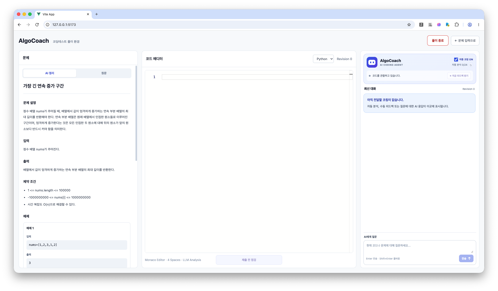

# AlgoCoach

**코딩하는 과정을 관찰하고, 필요한 순간에 먼저 도움을 제안하는 AI 코딩테스트 코치**

> **SKALA 광주 2반 · G051 박이완**  
> Vue 3 · TypeScript · Monaco Editor · FastAPI · LangGraph · OpenAI · SQLite

AlgoCoach는 문제 풀이 도중 작성되는 코드를 관찰하고, AI가 코드의 장점과 오류 가능성을 설명하며 필요 시 질문 응답·단계별 힌트를 제공하는 웹 애플리케이션입니다. 풀이를 대신하거나 정답을 자동 채점하는 서비스가 아니라, **학습자의 문제 해결 과정을 돕는 코칭 서비스**를 목표로 합니다.

## 주요 기능

- **문제 AI 구조화:** 원문 문제에서 목표·입출력·제약·예제를 정리하고 사용자 확인 후 풀이 화면으로 이동합니다.
- **3열 코딩 환경:** 문제 원문/AI 정리 · Monaco Editor · AlgoCoach 대화 피드로 구성합니다.
- **자동·수동 코드 분석:** 코드 변경과 안정화 시점을 관찰하고, 근거가 있을 때 AI 코칭을 표시합니다. `지금 피드백 받기`로 직접 요청할 수도 있습니다.
- **선제적 도움 제안:** 일정 시간 코드 변화가 없거나 반복 수정 징후가 관찰되면, 에이전트가 도움을 원하는지 먼저 묻습니다. 사용자가 수락한 경우에만 힌트를 생성합니다.
- **단계별 힌트:** 방향 → 알고리즘 → 구현의 3단계로 도움 수준을 조절합니다.
- **코드 맥락 질문:** 현재 문제·코드·최근 코칭을 바탕으로 질문하고, 답변을 하나의 대화 피드에 표시합니다.
- **근거 기반 오류 재검토:** 1차 LLM의 오류 후보를 별도 LLM 검토로 재평가하고, `SUPPORTED / REFUTED / UNRESOLVED`를 구분합니다.
- **제출 전 정적 점검:** 알고리즘·경계조건·복잡도 등을 정적으로 검토합니다. **코드를 실제 실행하거나 정답 여부를 보장하지 않습니다.**
- **풀이 종료 및 코칭 평가:** 최종 코드와 종료 정보, 코칭 품질에 관한 사용자 평가를 로컬 SQLite에 저장합니다.

<!-- 이미지 자리: docs/images/02-editor-coaching.png. 문제·에디터·코치 3열이 모두 보이는 캡처를 넣으세요. -->

## 실행 화면

이미지 파일을 직접 추가한 뒤 아래 주석을 이미지 링크로 교체하면 됩니다.

| 화면 | 권장 파일 | 캡처 포인트 |
|---|---|---|
| 문제 AI 구조화 | `docs/images/01-problem-structuring.png` | 원문과 구조화 요약 비교 |
| 메인 코칭 화면 | `docs/images/02-editor-coaching.png` | 문제·에디터·AlgoCoach 3열 전체 |
| 실제 오류 피드백 | `docs/images/03-error-feedback.png` | `>=` 비교 오류와 근거가 표시된 카드 |
| 선제적 힌트 | `docs/images/04-proactive-hint.png` | 먼저 도움 제안 → 수락 → 1단계 힌트 |
| 종료 및 평가 | `docs/images/05-session-feedback.png` | 최종 코드·피드백 저장 결과 |

<!-- 예시 — 캡처 파일을 넣은 후 다음 줄의 주석을 해제하세요.

```markdown

``` -->


## 사용 기술 및 버전

### 직접 확인한 프로젝트 명세

| 영역 | 패키지 / 환경 | 버전 또는 제약 |
|---|---|---|
| Python | `.python-version`, `pyproject.toml` | **3.11**, 지원 범위 `>=3.11,<3.14` |
| FastAPI | `pyproject.toml` | `>=0.115,<1.0` |
| LangGraph | `pyproject.toml` | `>=1,<2` |
| OpenAI Python SDK | `pyproject.toml` | `>=3.35.1` |
| Pydantic | `pyproject.toml` | `>=2,<3` |
| Pydantic Settings | `pyproject.toml` | `>=2,<3` |
| Uvicorn | `pyproject.toml` | `>=0.30,<1.0` |
| Node.js | `frontend/package.json` `engines` | `^22.18.0` 또는 `>=24.12.0` |
| Vue | `frontend/package.json` | `^3.5.42` |
| Vite | `frontend/package.json` | `^8.2.2` |
| TypeScript | `frontend/package.json` | `~6.0.0` |
| Monaco Editor | `frontend/package.json` | `^0.57.0` |
| SQLite | Python 표준 라이브러리 `sqlite3` | 별도 DB 서버 설치 불필요 |
| 실제 LLM | `OPENAI_MODEL` | 기본 예시 `gpt-5.4-mini` (변경 가능) |

**버전 표기 주의:** 위 표는 프로젝트에 선언된 버전 조건을 우선 표기한 것입니다.  
**최신 로컬 리포지터리의 lockfile이 갱신되었다면 그 파일의 버전이 최종 기준**입니다.  
설치 후 `npm ls --depth=0`, `uv pip list`로 재확인할 수 있습니다.

## 사전 준비

- Git
- Python 3.11(권장)과 [uv](https://docs.astral.sh/uv/)
- Node.js 24 LTS 계열(프로젝트 지원 조건을 만족하는 버전)과 npm
- 실제 OpenAI 모드 사용 시 API 키 및 호출 비용

이 프로젝트는 현재 **개발용 로컬 실행**을 기준으로 합니다. 별도 공개 서버나 계정 관리, 코드 실행·채점기는 제공하지 않습니다.

## 로컬 실행 방법

### 1. 프로젝트 내려받기

```bash
# 저장소 주소를 자신의 GitHub 리포지터리 URL로 교체하세요.
git clone <REPOSITORY_URL>
cd algocoach
```

이미 코드를 받은 경우 `cd algocoach`부터 시작하면 됩니다.

### 2. 백엔드 가상환경·의존성 설치

```bash
cd backend
uv python install 3.11
uv sync --python 3.11
```

`uv sync`는 `backend/pyproject.toml`과 `backend/uv.lock`을 기준으로 가상환경 및 의존성을 구성합니다.

환경변수 파일을 생성합니다.

```bash
cp .env.example .env
```

**기본 Mock 모드 (`backend/.env`):**

```dotenv
LLM_PROVIDER=mock
OPENAI_MODEL=gpt-5.4-mini
```

**실제 OpenAI 모드 (`backend/.env`):**

```dotenv
LLM_PROVIDER=openai
OPENAI_MODEL=gpt-5.4-mini
OPENAI_API_KEY=YOUR_OPENAI_API_KEY
```

> `.env`와 API 키는 Git에 커밋하지 마세요. 실제 키가 없는 경우 Mock 모드로 먼저 검증합니다. 모델 접근 권한과 과금은 사용하는 OpenAI 계정 설정을 따릅니다.

백엔드를 실행합니다.

**macOS / Linux**

```bash
source .venv/bin/activate
uvicorn app.main:app --host 127.0.0.1 --port 8000
```

**Windows PowerShell**

```powershell
.venv\Scripts\Activate.ps1
uvicorn app.main:app --host 127.0.0.1 --port 8000
```

가상환경을 활성화하지 않아도 `uv run uvicorn app.main:app --host 127.0.0.1 --port 8000`으로 실행할 수 있습니다.

연결 확인: <http://127.0.0.1:8000/api/v1/health> — `{"status":"ok"}` 예상. API 문서는 <http://127.0.0.1:8000/docs>에서 확인할 수 있습니다.

### 3. 프론트엔드 설치 및 실행

**다른 터미널**에서 프로젝트 루트 기준으로 실행합니다.

```bash
cd frontend
npm ci
npm run dev
```

브라우저에서 <http://127.0.0.1:5173>에 접속합니다. `frontend/vite.config.ts`에서 `/api` 요청은 `http://127.0.0.1:8000`으로 프록시합니다. 따라서 **백엔드와 프론트엔드 두 프로세스가 모두 실행 중이어야 합니다.**

### 4. 기본 사용 순서

1. 코딩테스트 문제 원문을 붙여 넣고 **AI 문제 정리**를 실행합니다.
2. 정리 결과를 확인한 후 **풀이 시작**을 누릅니다.
3. 가운데 Monaco 에디터에서 Python / Java / C++ / C 중 언어를 선택해 풀이합니다.
4. 오른쪽에서 자동 코칭 ON/OFF, 호출 상태, 최신 분석 결과, AI 질문, 선제적 도움 제안을 확인합니다.
5. 필요할 때 코치 헤더의 **지금 피드백 받기** 또는 에디터 아래의 **제출 전 점검**을 실행합니다.
6. 풀이를 종료하고 코칭 품질 평가를 저장합니다.

## 자동 코칭 정책

| 정책 | 기본값 |
|---|---:|
| 타이핑 안정화 | 2초 |
| 안정화 후 추가 관찰 | 6초 |
| 일반 자동 분석 최소 간격 | 25초 |
| 이전 경고 수정 재검증 최소 간격 | 12초 |
| 최근 10분 자동 분석 | 최대 8회 |
| 세션 자동 분석 | 24회(수동 리필 가능) |
| 선제적 정체 가능성 관찰 | 5초 주기로 로컬 검사 |
| 코드 무편집 시 도움 제안 후보 | 약 90초(빈 코드 약 120초) |
| 도움 거절 후 재제안 유예 | 약 180초 |
| 선제적 단계별 힌트 | 최대 3단계 |

24회 리필은 세션 카운터를 초기화하는 UX 기능이며, **최근 10분 호출 제한은 초기화하지 않습니다**. 이 제한은 프론트엔드의 사용 편의 및 비용 보호 정책이지 서버 단위 인증/청구 예산 시스템이 아닙니다.

## 주요 API

| Method | 경로 | 기능 |
|---|---|---|
| GET | `/api/v1/health` | 서버 확인 |
| POST | `/api/v1/dev/problems/structure` | 문제 구조화 |
| POST | `/api/v1/dev/analyze` | LangGraph 기반 코드 분석 |
| POST | `/api/v1/dev/coaching/ask` | 코드 맥락 질의응답 |
| POST | `/api/v1/dev/hints/next` | 다음 단계 힌트 |
| POST | `/api/v1/dev/submission/review` | 제출 전 정적 검토 |
| POST | `/api/v1/dev/sessions/complete` | 풀이 완료 기록 |
| POST | `/api/v1/dev/sessions/feedback` | 코칭 품질 평가 기록 |

최신 응답 모델과 API 요청 형식은 실행 중인 FastAPI의 `/docs`에서 확인하세요.

## 검증 방법

### 프론트엔드

```bash
cd frontend
npm run type-check
npm run build
```

설치한 코드에 관련 파일이 있다면 정책 스크립트도 별도로 실행할 수 있습니다.

```bash
node --experimental-strip-types scripts/test-autonomous-policy.mjs
node --experimental-strip-types scripts/test-proactive-policy.mjs
node --experimental-strip-types scripts/test-coaching-satisfaction.mjs
```

### 백엔드

```bash
cd backend
source .venv/bin/activate
python -m compileall -q app
python scripts/test_issue_verification.py
python scripts/test_coaching_quality.py
```

**실제 OpenAI 비교 테스트:** 백엔드가 `LLM_PROVIDER=openai`로 실행 중일 때 다음을 실행합니다. API 과금이 발생하며, 결과는 모델 출력에 따라 달라질 수 있습니다.

```bash
python scripts/test_coaching_quality.py --live --confirm-live
```

사용자 실측 검증에서는 정답인 순열 풀이 `issues=0`, 동률 정렬 기준을 누락한 오답 풀이 `issues=1`로 **대표 정/오답 2사례 통과**를 확인했습니다. 오프라인에서는 873개 순열의 사이클 성질을 검사했습니다. 전체 정답률을 의미하지 않습니다.

> 현재 제공된 기록에서는 `python -m pytest -q` 실행 시 `no tests ran`이 나왔습니다. 따라서 **pytest 전체 테스트가 통과했다고 주장하지 않습니다.** 위 독립 스크립트와 실제 브라우저 시연을 별도 검증 근거로 사용합니다.

## SQLite 저장

기본 파일: `backend/data/algocoach.sqlite3`

| 테이블 | 저장 내용 |
|---|---|
| `session_completions` | 세션 ID, 문제 원문, 최종 코드, 언어, 종료 방식 및 사용자가 보고한 외부 채점 결과 등 |
| `session_feedback` | 완료 세션에 대한 코칭 품질 평가, 선택적 의견 |

로컬에 `sqlite3` 명령줄 도구가 설치되어 있다면 프로젝트 루트에서 다음처럼 확인할 수 있습니다.

```bash
sqlite3 backend/data/algocoach.sqlite3 \
  'SELECT session_id FROM session_completions LIMIT 5;'
```

서버에 사용자 계정과 클라우드 동기화 기능은 없습니다. 외부 온라인 저지 결과는 **사용자 입력에 의한 보고 값**이며 AlgoCoach의 자동 채점 결과가 아닙니다.

## 아키텍처·기술적 범위

- 상세 구현 흐름·LangGraph 구성·개입 정책·회귀 검증: [최종 아키텍처 문서](docs/architecture.md)
<!-- - 5분 발표와 최종 보고서를 겸하는 자료 원고: [최종 발표 구성안](docs/final-report-presentation.md) -->

## 한계와 향후 개선

- 무입력 시간과 코드 수정 패턴은 실제 학습자의 이해도나 정체 상태를 완벽하게 설명하지 못합니다.
- 2차 LLM 검토 역시 오류를 놓치거나 잘못 반박할 수 있으며 응답 지연과 비용이 증가합니다.
- 코칭 타이밍 임계값은 사용성 실험과 실제 평가 데이터를 통해 조정할 필요가 있습니다.
- 저장된 세션·코칭 품질 평가를 기반으로 코칭 효과/개입 시점을 분석하는 대시보드를 확장할 수 있습니다.
- 향후 근거 검색(RAG), 외부 도구 연계(MCP), LangGraph 전문 에이전트 분리, LangSmith 추적 등을 검토할 수 있습니다.

## 만든 사람

**박이완 · SKALA 광주 2반 G051**

> 코드 리뷰와 코칭의 본질은 단순히 자주 말하는 것이 아니라, **근거가 있는 순간에 적절하게 개입하는 것**이라는 문제의식에서 출발했습니다.
