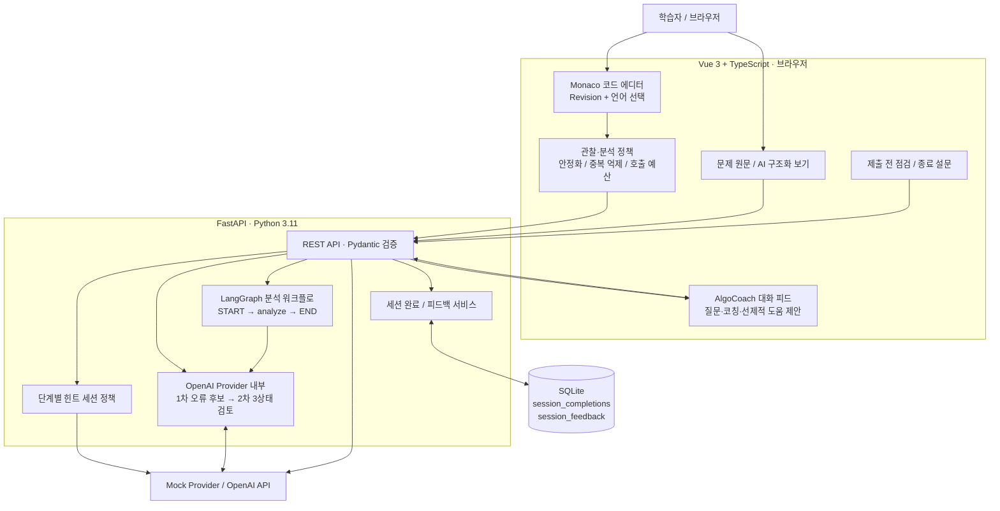
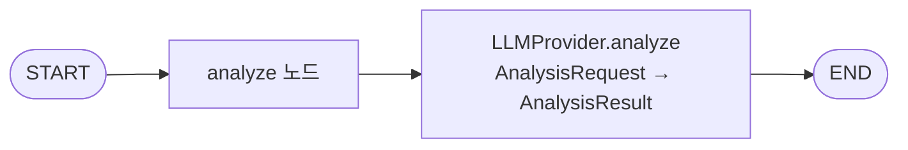
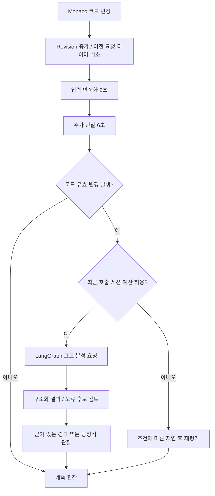
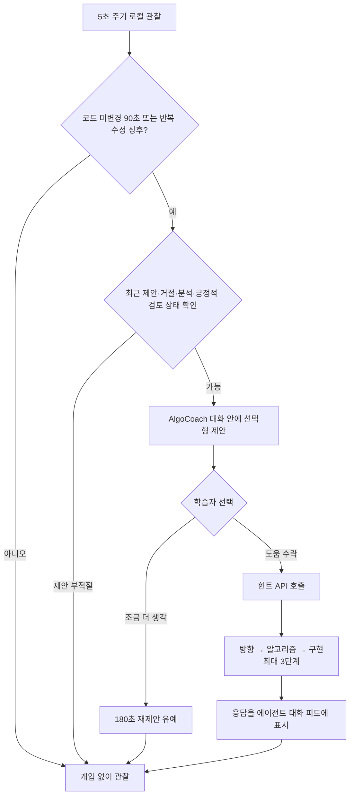

# AlgoCoach — 최종 아키텍처 및 구현 명세

> SKALA 광주 2반 · G051 박이완  
> 최종 보고서용 구현 기준 문서 · 2026-10-22  
> **문서 원칙:** 실제 구현을 확인한 기능과 향후 확장 아이디어를 구분한다. AI 정적 분석을 자동 채점이나 정답 보증으로 표현하지 않는다.

## 1. 시스템 개요

**AlgoCoach**는 코딩테스트 문제를 푸는 동안 학습자의 코드 변화를 관찰하고, 필요하다고 판단되는 시점에 코드 분석·피드백·질문 응답·단계별 힌트를 제공하는 AI 코칭 웹 애플리케이션이다. 핵심 목표는 정답 생성보다 **학습 과정에서 개입 타이밍과 개입 수준을 조절하는 것**이다.

대표 사용자 흐름:

1. 문제 원문 입력 → AI가 목표·입출력·제약·예제를 구조화 → 사용자 확인.
2. 3분할 화면에서 문제를 읽고 Monaco 에디터로 풀이 작성.
3. 브라우저가 코드 변경·Revision·입력 안정화·호출 이력을 관찰.
4. 의미 있는 코드 변경 시 FastAPI 분석 요청 → LangGraph 코드 분석 노드 → 선택한 LLM Provider.
5. OpenAI 모드에서는 오류 후보에 대한 **독립 2차 LLM 검토**를 수행하고, 검토 결과에 따라 강한 경고·추가 확인·제외를 구분.
6. 학습자가 질문하거나, 정체 징후에 대한 선제적 제안을 수락하면 맥락 기반 응답·단계별 힌트 제공.
7. 제출 전 정적 점검 → 풀이 종료·코칭 품질 설문 → 로컬 SQLite 저장.

## 2. 기술 스택 및 적용 범위

| 계층 | 적용 기술 | 실제 담당 역할 |
|---|---|---|
| 프론트엔드 | Vue 3, TypeScript, Vite 8 | SPA, 반응형 상태 관리, 3열 풀이 UI |
| 코드 입력 | Monaco Editor 0.57 | Python / Java / C++ / C 편집 및 구문 강조 |
| API | Python 3.11, FastAPI, Uvicorn | 문제 구조화, 분석, 질문, 힌트, 점검, 종료/설문 |
| AI 오케스트레이션 | LangGraph 1.x | **코드 분석 경로에 `START → analyze → END` 단일 노드 StateGraph** |
| 생성형 AI | OpenAI SDK, `gpt-5.4-mini`(예시 설정), Pydantic | 구조화 응답과 정적 분석; Mock/OpenAI 선택 |
| 코칭 판단 | 프론트엔드 TypeScript 정책 함수 | 입력 안정화, 분석 예산, 개입 여부, 정체 징후, 중복 억제 |
| 오류 신뢰도 | 1차 분석 + 2차 독립 LLM 검토 | `SUPPORTED / REFUTED / UNRESOLVED` 3상태 판정 |
| 저장 | Python `sqlite3`, SQLite | 풀이 종료 내용, 최종 코드, 코칭 품질 평가 |
| 개발 검증 | Mock Provider, 오프라인 회귀 스크립트, 실제 OpenAI 비교 | 정책/순열 성질 및 대표 정·오답 사례 검증 |

**적용 여부에 관한 정확한 설명:** LangGraph 사용은 확인되지만, 현재 확인한 그래프는 단일 분석 노드다. **Supervisor 기반 Multi-Agent, 동적 재계획, MCP 서버/도구, RAG·Vector DB, LangSmith 트레이싱은 구현 완료 기능으로 확인되지 않는다.** 2차 검증은 별도의 LLM 판단 호출이지만 LangGraph 내부의 독립 전문 서브에이전트 노드로 구성된 것은 아니다. 이를 완성된 Multi-Agent 시스템이라고 부르지 않는다.

## 3. 완성형 구성도



**그림 해설:** 분석 트리거와 선제적 도움 판단은 브라우저에서 수행하고, 실제 자연어 판단·응답은 서버의 LLM Provider가 담당한다. LangGraph가 직접 관장하는 것은 코드 분석 호출 경로이다. 문제 구조화·힌트·제출 전 점검 등은 FastAPI 서비스에서 Provider를 직접 호출하는 경로도 있다. 위 그림의 화살표는 역할 관계의 요약이며, 모든 요청이 그래프를 경유한다는 뜻은 아니다.

### 3.1 주요 코드 구조

```text
algocoach/
├── README.md
├── docs/
│   ├── architecture.md
│   ├── final-report-presentation.md
│   └── images/               # 사용자 스크린샷
├── backend/
│   ├── .env.example
│   ├── .python-version       # 3.11
│   ├── pyproject.toml / uv.lock
│   ├── app/
│   │   ├── main.py
│   │   ├── agents/graph.py   # 분석용 LangGraph
│   │   ├── api/              # FastAPI 라우터
│   │   ├── llm/              # Mock/OpenAI Provider, 검증 지침
│   │   ├── schemas/          # Pydantic 요청/응답
│   │   └── services/         # 힌트, 종료, 피드백 저장
│   └── scripts/             # 스모크·회귀 테스트
└── frontend/
    ├── package.json / package-lock.json
    ├── vite.config.ts       # /api → localhost:8000 프록시
    └── src/
        ├── App.vue
        ├── components/       # Workspace, Coach, Editor, Hint
        ├── services/         # API 클라이언트, 개입 정책
        ├── composables/      # 코드 이력, Idle 추적
        ├── styles/
        └── types/
```

## 4. LangGraph의 **실제** 역할

확인된 그래프 구현(`backend/app/agents/graph.py`):



`AnalysisGraphState`는 요청과 분석 결과를 전달한다. `POST /api/v1/dev/analyze`에서 `graph.ainvoke(...)`로 호출한다. **Supervisor·복수 전문 에이전트·동적 노드 라우팅은 현 단계에서 미구현**이다. 검증 모델 재호출은 Provider의 분석 처리 내부에서 발생하는 별도 검토 단계로 구분한다.

## 5. 자동 분석과 자율 개입 의사결정

### 5.1 코드 관찰 → 자동 분석



현재 프론트엔드 정책 상수 기준:

| 기준 | 설정 | 의도 |
|---|---:|---|
| 입력 안정화 | 2초 | 일시적 미완성 코드 분석 완화 |
| 추가 관찰 | 6초 | 짧은 사고 시간을 배려 |
| 일반 요청 최소 간격 | 25초 | 자동 호출 중복·비용 방지 |
| 기존 경고 수정 우선 재확인 간격 | 12초 | 중요한 수정에 더 빠르게 응답 |
| 최근 요청량 | 10분당 8회 | 단기간 집중 호출 방지 |
| 세션 자동 분석 기본 한도 | 24회 | 세션 내 예산 보호 |
| 수동 리필 | 0/24로 초기화 | 긴 풀이를 지원; 최근 10분 제한은 그대로 |
| 동일 코드 | 중복 분석 요청 억제 | 비용·반복 개입 감소 |
| 코칭 메시지 간격 | 최소 25초 정책 | 과도한 알림 완화 |

모든 수치는 실험적 UX 정책이며 **정확한 학습 난이도를 측정한 값이 아니다**. 특히 24회 제한과 리필은 브라우저 측 제어다. 서버 전체 비용을 통제하는 인증·공유 예산 제한으로 해석하지 않는다.

### 5.2 선제적 도움 제안



정체 *의심* 신호: 무편집 약 90초(빈 코드 약 120초), 또는 120초 관찰 구간에 여러 번 안정화된 수정이 반복되면서 코드 길이 변화가 작을 때. 이 규칙은 사용자의 심리나 이해도를 확정 판정하지 않고, **도움을 원하는지 묻는 계기**로만 활용한다. 제안 거절 후 약 180초 동안 재제안을 억제한다. 최신 Revision의 긍정적인 정적 검토가 있으면 코드가 크게 바뀌기 전까지 불필요한 도움 제안을 억제한다.

**중요한 구분:** `HintSessionStore`는 1→2→3단계 힌트를 관리한다. 세션당 힌트 3단계와 자동 분석 24회 예산은 서로 다른 개념이다. 힌트 콘텐츠는 사용자가 선제적 제안을 수락할 때 생성된다.

## 6. 정확도 개선: 근거 중심 1차 분석 + 2차 검토

1. **1차 분석:** 원문 문제와 현재 코드를 읽고 정적 분석한다. 구현 알고리즘, 진행 상태, 긍정적 관찰, 오류 후보와 해당 코드 근거를 구조화한다.
2. **2차 검토:** 오류 후보가 있을 때 별도 LLM 호출로 후보별 실패 근거를 재평가한다.
3. **3상태 결과:** `SUPPORTED`(근거 충분 → 오류 경고 유지), `REFUTED`(반박됨 → 제외), `UNRESOLVED`(불확실 → INFO/LOW 수준 추가 확인으로 강도 완화).
4. **UX 판단:** 최신 코드 Revision과 분석 결과의 Revision이 일치할 때만 표시한다. 긍정적 분석·제출 전 점검 신호는 실제 채점 결과가 아닌 **정적 검토 상태**로 표현한다.

2차 검토도 LLM 판단이므로 잘못된 지적을 완전히 방지할 수 없고, 실제 버그를 반박하는 오류(False Negative)도 가능하다. 오류 후보가 존재하는 요청은 LLM 호출이 1회 더 발생해 지연·비용이 증가한다. 별도 Python 코드 실행기, 정식 온라인 저지, 샌드박스 실행은 구현하지 않았다.

### 6.1 실제 검증 결과 (대표 사례, 일반화 금지)

**LeetCode 3551 — Minimum Swaps to Sort by Digit Sum**

| 구분 | 최종 라이브 분석 결과 |
|---|---|
| 올바른 순열 사이클 풀이 | `REVIEWING`, `issues=0` |
| 동률 시 숫자 오름차순 키 누락 | `DEBUGGING`, `issues=1`, `CRITICAL` |
| 대표 반례 | `nums=[21,12]`: 오답 코드 0회 반환 vs 정답 1회 |
| 오프라인 확인 | 873개 순열에서 역순열의 사이클 개수 동일; 길이 1~5는 독립 BFS 검산 |

중간 테스트에서 **정답 코드 오탐**과 **오류 코드 누락** 모두 발생했으며, 검증 정책을 여러 차례 수정한 뒤 위 두 사례가 통과했다. 이 검증은 **대표 테스트 2건의 성공**이지 전체 정확도·오탐률·재현성을 통계적으로 보장하는 실험이 아니다.

## 7. API 흐름 및 데이터 계약

API 기본 주소(개발): `http://127.0.0.1:8000`. Vite는 `/api` 요청을 위 서버로 프록시한다.

| Method / Path | 책임 | 처리 경로 |
|---|---|---|
| `GET /api/v1/health` | 헬스 체크 | FastAPI |
| `POST /api/v1/dev/problems/structure` | 문제 구조화 | LLM Provider 직접 |
| `POST /api/v1/dev/analyze` | 코드 분석 | LangGraph → Provider (+ 필요 시 2차 검토) |
| `POST /api/v1/dev/coaching/ask` | 사용자 AI 질문 | LLM Provider 기반 질문 API |
| `POST /api/v1/dev/hints/next` | 다음 힌트 제공 | 힌트 세션 정책 + Provider |
| `POST /api/v1/dev/submission/review` | 제출 전 정적 점검 | Provider (+ 필요 시 2차 검토) |
| `POST /api/v1/dev/sessions/complete` | 풀이 종료 | SQLite |
| `POST /api/v1/dev/sessions/feedback` | 코칭 품질 평가 | SQLite, 완료 세션 확인 |

> 질문 API는 최신 프론트엔드의 실제 호출 경로로 확인되었다. 백엔드의 초기 첨부 스냅샷보다 후속 Stage에서 확장된 부분으로, 배포 전에는 최신 백엔드 소스와 다시 대조하는 것이 좋다.

요청/응답은 HTTP JSON과 Pydantic 모델을 이용한다. **SSE 스트리밍/실시간 토큰 스트리밍을 적용한 것으로 기술하지 않는다.** API 응답 대기 중 프론트엔드에서 실제 요청 상태를 표시한다.

## 8. 상태·데이터 보존 전략

- **브라우저 세션 상태:** 코드 Revision, 최근 자동 분석 시각/횟수, 에이전트 메시지, 질문 맥락, 선제적 제안·수락·거절, 로컬 변경 이력. 주로 Vue 반응형 상태/타이머로 관리한다.
- **힌트 단계:** 백엔드 세션 스토어가 순서를 제어한다. 초기 첨부 코드에서 `HintSessionStore`는 영속 데이터베이스가 아닌 프로세스 메모리 기반이다.
- **SQLite(`backend/data/algocoach.sqlite3`):** `session_completions`(최종 코드·언어·문제·종료 정보 포함 요청 JSON과 영수증), `session_feedback`(코칭 정확성·유용성 평가/의견 등 요청 JSON과 영수증)을 저장한다.
- **일관성:** 세션 종료 1회, 완료한 세션에 대한 평가 1회. 같은 내용 재요청은 기존 영수증 반환, 상충한 재요청은 거부한다.
- **주요 한계:** 전체 키 입력 이력, 모든 자동 코칭 메시지 및 모든 힌트가 SQLite에 자동 영속화되는 구조는 아니다. 로그인·클라우드 동기화·공용 대시보드는 없다.

## 9. 안전성 및 트레이드오프

| 설계 선택 | 장점 | 비용 / 한계 |
|---|---|---|
| Mock/실제 OpenAI Provider 분리 | API 비용 없는 기능 개발·검증 | Mock으로 실제 품질을 확인할 수 없음 |
| 브라우저 기반 관찰 Gate | 빠른 UI 응답, 불필요한 요청 억제 | 탭 비활성화·브라우저 상태에 영향; 서버 강제 예산 아님 |
| 2차 LLM 오류 검토 | 단정적인 오탐을 줄이려는 시도 | 추가 호출·지연·2차 검토의 오판 가능성 |
| 힌트 요청에 동의 필요 | 학습 자율성·정답 누출 억제 | 제안 시점이 늦거나 불필요할 수 있음 |
| 코드 실행기 미제공 | 실행 보안 위험과 구현 범위 절감 | 최종 정답 판정 불가 |
| SQLite 기록 | 최소 설정으로 영속 저장 | 다중 사용자·공유 운영 기능 없음 |

## 10. 테스트 및 관측 현황

- 실제 OpenAI 대표 정/오답 2사례 라이브 회귀 검사 통과(사용자 실행 로그 기반).
- 오프라인 순열/역순열 비교 873사례와 짧은 순열 독립 BFS 검산 통과.
- `backend/scripts/test_issue_verification.py`의 3상태 검증 단위 검사 통과.
- TypeScript 정책 함수 검사 및 사용자가 수행한 화면 단위 확인.
- 사용자가 `pytest`를 실행했을 때 **`no tests ran`**: 전체 pytest 스위트가 구성되어 통과했다는 주장은 하지 않는다.
- **LangSmith 트레이싱, 모델별 전수 평가, 정량 지표 대시보드, 정식 LLM-as-a-Judge 평가 파이프라인**은 확인된 구현 범위에 포함되지 않는다. 2차 LLM 검토는 **개별 오류 후보 재심사**이지 정식 벤치마크 평가 시스템이 아니다.

## 11. 향후 고도화

1. **개입 품질:** 코드 길이뿐 아니라 AST/구문 트리, 변경 부위, 이전 경고 재발 여부로 정체 신호 정교화; 실제 사용자 평가로 임계값 조정.
2. **정확도:** 문제별 정/오답 벤치마크 확보, LLM 2차 검토의 False Positive/False Negative 측정, 안전한 격리 실행기로 반례 검산.
3. **LangGraph 확장:** 필요성이 검증되면 문제 해석/분석/검증 역할을 개별 노드와 Supervisor로 분리하고 상태 추적·동적 라우팅 구현.
4. **MCP/RAG 확장:** 문제 해설/알고리즘 자료를 라이선스·출처 관리 하에 검색하는 도구, 표준 MCP 인터페이스 및 검색 근거 주입 검토.
5. **관측 가능성:** LangSmith 또는 OpenTelemetry를 도입하여 호출 수·지연·에이전트 개입·비용을 계측하고 정량 LLM-as-a-Judge 평가 구축.
6. **데이터 활용:** 저장된 완료 세션/코칭 품질 평가를 집계하는 비식별 통계·개입 시점 평가·진전율 대시보드 도입.

---

### 이미지

스크린샷 경로: `docs/images/`

- `01-problem-structuring.png`: 문제 입력 후 AI 구조화 화면
- `02-editor-coaching.png`: 문제·Monaco·AlgoCoach 3열 전체 화면
- `03-error-feedback.png`: `>=` 오류를 발견한 최신 코칭
- `04-proactive-hint.png`: 선제적 제안과 수락 후 힌트
- `05-session-feedback.png`: 풀이 종료 및 평가 저장 화면
