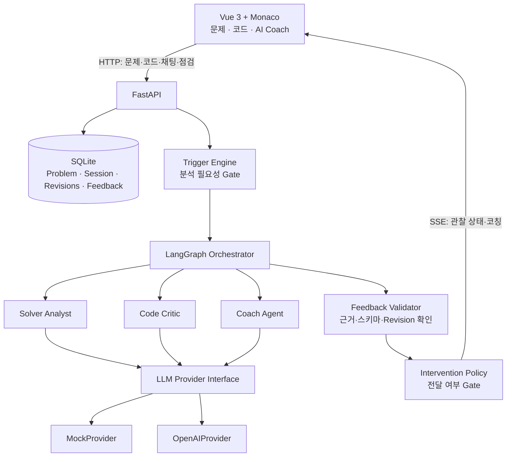

# AlgoCoach — 아키텍처 및 개발 계획서

> **문서 버전:** v1.1 (Vue 전환)  
> **기준일:** 2026-10-20  
> **상태:** 개발 착수용 아키텍처 기준선 (Architecture Baseline)  
> **프로젝트:** SKALA AI Mini-Project — 과제 2(신규 AI Agent)

### 변경 이력

| 버전 | 날짜 | 변경 사항 |
|---|---|---|
| v1.0 | 2026-10-20 | 초기 아키텍처 기준선 |
| **v1.1** | **2026-10-20** | **Frontend를 React에서 Vue 3로 변경. Vue Composition API, `.vue` SFC, Monaco 연동 및 프론트↔백엔드 개발 통신 원칙 추가. Python 3.11 가상환경 확인 결과와 단계별 구현 계획 반영.** |

---

## 0. 문서 목적과 개발 원칙

이 문서는 기획 대화에서 확정한 AlgoCoach의 목표, 사용자 경험, 기술 스택, 데이터 흐름, AI 개입 정책, 평가 및 구현 범위를 기록한다. 구현 중 세부 수치나 기술 선택이 달라지면 이 문서를 수정하여 기록한다.

**핵심 가치:** 사용자가 질문해야만 응답하는 챗봇이 아니라, **코딩테스트 풀이 과정을 관찰하고 필요한 순간에 필요한 수준만큼 자율적으로 개입하는 AI 코치**를 구현한다.

**개발 원칙**

1. 사용자가 직접 개발·실행·테스트한다. AI는 코드와 정확한 파일 경로, 검증 절차, 오류 해결 방법을 제공한다.
2. 기능은 **작은 작업 단위**로 분리한다. **작업 → 사용자 테스트 → 해당 단계 커밋 메시지 제안 → 사용자 커밋 완료 → 다음 작업** 순서를 반드시 지킨다. 미완료 작업과 다음 작업의 변경사항을 섞지 않는다.
3. 기본 동작이 안정화되기 전에는 부가 기능을 도입하지 않는다. 처음에는 Mock으로 시스템 흐름을 검증하고 이후 OpenAI API로 실제 추론 품질을 평가한다.
4. 높은 품질의 코칭을 위해 기능 개수보다 **판단 근거·개입 타이밍·사용자 몰입·피드백 유효성**을 우선한다.
5. 사용자가 요청하면 지정한 단일 파일을 **복사·붙여넣기로 교체할 수 있는 전체 코드**로 제공한다. 모든 변경에는 경로와 검증 명령을 명시한다.
6. Python 코딩테스트 풀이에 집중한다. 사용자 코드의 서버 측 실행 및 자체 채점은 초기 범위에 포함하지 않는다.

## 1. 배경과 목표

### 1.1 기존 방식의 문제

- 일반적인 AI 코딩 도우미는 사용자가 질문을 작성해야만 반응한다.
- 풀이 전략이 발전하거나 구현에 논리적 결함이 생겼을 때, 도움을 요청하기 전까지는 상황을 파악하지 못한다.
- 과도한 자동 개입은 사용자의 자율적 문제 해결과 집중을 방해한다.
- 일회성 응답만으로는 **이전 피드백 → 코드 수정 → 후속 결과**를 연결하기 어렵다.

### 1.2 제품 정의

**AlgoCoach**는 사용자가 문제 텍스트를 붙여넣어 Python 코딩테스트를 풀면, 문제의 제약과 코드 변경 이력, 정체 신호, 이전 AI 피드백을 기반으로 풀이 전략을 추론하고 적절한 시점에 선제적 피드백을 제공하는 **상태 기반 자율 코칭 Agent**다.

### 1.3 제품이 지향하는 경험

- 문제를 복사해 붙여넣으면 AI가 원문을 보존하면서 설명·제약·입출력·예제를 정리한다.
- 기본 화면은 **문제 / Monaco 에디터 / AI 코치**의 3영역으로 구성한다.
- 오른쪽의 코치 패널은 채팅 입력창이 아닌 **관찰 상태 + 자율 코칭 피드** 중심이다.
- 사용자가 잘 진행 중이면 조용히 기다리되, 충분히 근거 있는 긍정적 접근을 발견하면 가끔 격려한다.
- 논리 오류·제약 불일치·정체 가능성이 있으면 자연스러운 타이밍에 필요한 만큼만 설명한다.
- 상세 코칭은 `자세히 확인하기`로 단계적으로 공개한다.
- 채팅은 평소 닫혀 있으며, `AI에게 질문` 버튼을 누르면 열리는 보조 기능이다.
- 사용자가 `제출 전 점검`을 누르면 현재 코드를 정적 검토하고 긍정/수정 필요/판단 보류를 명확히 표시한다.
- `풀이 종료` 후 선택형 회고 설문을 제시하고 초기 문제 입력 화면으로 돌아간다.

## 2. 과제 조건과 평가 대응

교육 자료에 따르면 과제 2는 주제 제한 없이 신규 AI Agent를 개발할 수 있고 AI 개발 도구 사용도 허용된다. 다만 제출자는 코드와 설계를 직접 설명할 수 있어야 한다.

| 평가 기준 | 배점 | 대응 방법 |
|---|---:|---|
| 기능 구현 완성도 | 30 | 실제 문제 입력 → 코딩 → 자동 개입 → 제출 전 점검 시연 |
| 기술 요소의 적절한 활용 | 30 | LangGraph, 역할 분리, 상태 관리, Pydantic, 테스트, 관측 |
| 한계·트레이드오프 | 20 | 정확도 vs 비용·지연·방해 수준, 정적 분석 한계 설명 |
| 발표 자료 및 발표 | 20 | 문제 → 아키텍처 → 실제 시연 → 정량 평가 → 한계 |
| Before/After 실측 보너스 | +10 | 고정 폴링 vs 이벤트 기반 개입 정책 비교 |

**일정 가정:** Day 1~2에 핵심 기능을 구현하고 Day 3의 결과 보고와 발표에 대비한다. 실측 수치나 정확도는 직접 검증한 결과만 발표한다.

## 3. 확정된 기술 스택

| 계층 | 선택 | 비고 |
|---|---|---|
| Python | **3.11 기본**, 3.12~3.13 호환 고려 | `requires-python = ">=3.11,<3.14"` 권장; 3.11에서 우선 검증 |
| Python 패키지·환경 | `uv` | 환경·의존성 관리 |
| Node 버전 관리자 | `fnm` | 초기 설정 단계에서 버전/명령 안내 |
| Frontend | **Vue 3 + TypeScript + Vite** | SKALA 학습 연속성 우선, `.vue` SFC·Composition API 활용 |
| 에디터 | Monaco Editor (**Vue 컴포넌트로 캡슐화**) | Python 편집, 변경 이벤트, 행 강조; 설치·래퍼 선택은 해당 단계에서 검증 |
| Backend | FastAPI + Pydantic | API·입출력 스키마·유효성 검증 |
| Agent | LangGraph | 상태·조건부 라우팅·역할 분리 |
| 영속 저장 | SQLite | 문제, 세션, 코드 버전, 대화, 피드백 |
| 서버 → 화면 이벤트 | SSE | Agent 상태 및 코칭 결과 전달 |
| LLM Provider | Mock → OpenAI | Ollama는 장래에 추가할 수 있는 선택 기능 |
| 테스트 | pytest + 프론트엔드 기본 테스트 | 정책/상태/응답 검증 |
| 관측 | LangSmith | Trace 우선, 자체 관리자 UI 후순위 |

**개발 장비 전략:** 교육장 MacBook Pro에서 Mock·OpenAI, 집 OMEN 노트북에서 OpenAI를 사용한다. Ollama 설치를 MVP의 선행 조건으로 두지 않는다. Node.js는 `fnm`으로 관리하고 `npm`으로 의존성을 설치한다. 교육장 환경에서는 `fnm 1.39.0`, Node.js `24.19.0`, npm `11.17.0`이 확인되었다. Python은 `uv`로 생성한 `backend/.venv`를 `source .venv/bin/activate`로 활성화하며 Python `3.11.15` 실행이 확인되었다.

### 3.1 Vue 3 프론트엔드 구현 원칙

- **Vue 공식 스캐폴딩인 `create-vue` + Vite**를 사용한다. 세부 생성 명령 및 옵션은 프론트엔드 초기화 단계에서 안내한다.
- UI는 Vue Single-File Component (`.vue`)로 구성하며, 학습·설명 용이성을 위해 **Composition API + `<script setup>`**을 기본으로 한다.
- `ref`, `computed`, `watch`, `onMounted`, `onUnmounted`(또는 `onBeforeUnmount`) 등 명시적인 기본 API 중심으로 작성한다. 불필요한 고차 추상화와 복잡한 TypeScript 패턴은 지양한다.
- 공유 상태는 초기에는 최상위 화면 및 소규모 composable 함수로 관리한다. **Pinia와 Vue Router는 초기 필수 의존성으로 넣지 않는다.** 화면과 상태가 복잡해졌을 때 단계적으로 도입한다.
- `ProblemInput`, `ProblemPanel`, `CodeEditor`, `CoachPanel`, `ReviewResult`, `SessionSurvey` 등 사용자 경험 단위로 컴포넌트를 나누되, 초기부터 모든 파일을 생성하지 않는다.
- **Monaco Editor는 독립된 `CodeEditor.vue` 내부에만 마운트**하고, 코드 변경·선택 행 등은 Vue의 이벤트/props로 외부에 전달한다. 에디터를 언마운트할 때 리스너·에디터 인스턴스를 정리한다.
- Monaco Vue 래퍼 패키지 또는 `monaco-editor` 직접 연동은 Stage 7에서 Vite 호환성·Worker 설정·의존성 수를 검증한 뒤 **한 가지 방식만** 채택한다. 외부 CDN 의존성은 기본값으로 전제하지 않는다.
- Vue 타입 확인은 `vue-tsc`를 포함한 프로젝트 빌드/검사로 수행한다. TypeScript는 API 요청·응답 데이터 모델 위주로 사용하여 학습 부담을 최소화한다.

### 3.2 별도 개발 서버·API 통신 원칙

- **Frontend(Vite)**: `http://localhost:5173`, **Backend(FastAPI)**: `http://127.0.0.1:8000`를 개발 기본값으로 한다. 배포·Docker는 본 과제 범위 밖이다.
- 브라우저의 Vue 앱은 `fetch('/api/v1/...')`, `EventSource('/api/v1/.../events')`처럼 **상대 경로**로 통신한다. Vite `server.proxy`에서 `/api`를 FastAPI로 전달한다.
- 개발 프록시 사용 시 브라우저는 동일 출처로 요청한다. FastAPI의 CORS 설정은 별도로 명시적으로 관리하고, 직접 브라우저 접근이 필요한 개발 출처만 허용한다(`http://localhost:5173`, `http://127.0.0.1:5173`).
- 외부 브라우저 코드에 `OPENAI_API_KEY` 등 비밀을 포함하지 않는다. `VITE_` 환경 변수도 브라우저에 공개되는 값으로 간주한다.
- 백엔드는 FastAPI의 `lifespan`에서 공유 클라이언트 등 리소스를 초기화/종료한다. 네트워크 I/O와 모델 호출은 비동기 처리를 우선하고, 요청 취소 및 Revision 확인으로 오래된 피드백 표시를 방지한다.


## 4. MVP 범위와 제외 범위

### 4.1 필수 기능 (Must-have)

1. 원문 보존을 전제로 한 문제 텍스트 입력 및 AI 구조화(문제 설명, 제한, 입출력, 예제).
2. Python Monaco 에디터: 문법 강조, 4칸 공백 들여쓰기, 기본 단어 제안, 자동 괄호·따옴표, 자동 저장.
3. 편집 이벤트/코드 Revision/풀이 세션 상태 수집.
4. 문제 제약과 풀이 코드를 분석하는 LangGraph 기반 3역할 Agent.
5. 이벤트 + 편집 안정화 + Heartbeat에 기반한 균형형 자율 개입.
6. 알고리즘 접근법에 대한 **근거 있는 긍정 피드백**, 논리 오류 및 복잡도 경고.
7. 단계별 힌트와 `자세히 확인하기`.
8. 평소 닫힌 채팅; 사용자 질문 시 현재 코드·이전 판단을 반영.
9. `제출 전 점검`: 현재 코드에 대한 정적 검토, 3단계 결과 UI.
10. 외부 채점 결과(WA/TLE/RE/AC 등)를 사용자가 입력하면 후속 분석.
11. `풀이 종료`와 간단한 선택형 설문 UI(시간 부족 시 저장 기능을 축소).
12. Mock/OpenAI Provider 선택, 핵심 실패 처리와 API 키 보호.

### 4.2 핵심 동작 이후의 확장 (Should-have)

- Feedback Lifecycle의 상세한 해결 상태 추적 및 히스토리 표시.
- 특정 코드 행 강조·클릭 이동 기능의 개선.
- 자동 정체(Stuck) 추정의 고도화 및 튜닝.
- LangSmith Trace, 호출 지표와 테스트 로그 비교.
- Counterexample Explorer(실행하지 않는 반례 후보 추론) Agent.

### 4.3 이번 과제에서 제외 (Out of scope)

- 자체 채점기 및 온라인 저지 연동.
- 사용자가 작성한 임의 Python 코드의 서버 실행·Sandbox 구축.
- 외부 문제 사이트 스크래핑, 로그인·제출 자동화.
- 다중 언어 코딩테스트 지원, AI 정답 코드 자동완성, RAG 지식베이스, MCP 서버.
- 사용자 계정·팀 관리, 완성형 관리자 대시보드.

## 5. 상위 아키텍처



**역할 구분:** Vue Frontend는 코드 입력·표시 및 사용자 상호작용, Backend는 상태 및 이벤트 관리, LangGraph는 문제·코드에 대한 추론, deterministic policy는 불필요한 호출·과잉 개입·오래된 결과 표시를 통제한다. **Vue로의 교체는 프론트엔드 내부 구현만 바꾸므로 백엔드 API와 LangGraph 책임은 그대로 유지된다.**

## 6. AI 구성과 책임

### 6.1 Problem Interpreter (세션 초기화 기능)

- 입력: 사용자가 붙여넣은 원본 문제.
- 출력: 구조화된 문제(설명/조건/제약/예제/모호한 부분).
- 원문을 보존한다. 숫자·부등호·입출력 형식을 임의로 보정하지 않는다.
- 구조화 결과는 수정 가능해야 하고 확신할 수 없는 부분을 표시한다.
- 별도 상주 Agent로 유지할 필요는 없다.

### 6.2 Solver Analyst

- 알고리즘 후보(BFS/DFS/DP/그리디/다익스트라 등), 현재 풀이 단계, 사용 근거를 추론한다.
- 단일 API 이름(`heapq` 등)만으로 알고리즘을 확정하지 않고 코드 맥락과 제약을 연결한다.
- 미완성 상태와 결함이 확인된 구현을 구분한다.

### 6.3 Code Critic

- 코드의 논리적 누락, 조건 분기 오류 가능성, 경계 조건, 시간·공간복잡도 위험을 검토한다.
- 문제 제약과 코드의 접근법을 비교한다.
- 정적 추론만으로 오류를 확정할 수 없는 경우 **가능성/불확실성**을 명시한다.
- 필요할 때만 호출해 비용과 지연을 줄인다.

### 6.4 Coach Agent

- 분석 결과를 사용자가 이해하기 쉬운 코칭 메시지로 변환한다.
- 긍정적 접근에는 이유를 포함한 칭찬, 위험한 접근에는 과도하지 않은 경고를 제공한다.
- 사용자에게 알려줄 힌트의 수준을 관리한다.
- 채팅에서는 현재 코드와 과거 피드백 및 새로 입력된 외부 채점 결과를 함께 고려한다.

### 6.5 Feedback Validator / 정책 노드

- AI의 입력·출력 스키마, 관련 코드 Revision, 참조 행 번호, 근거 유무, 최근 동일 피드백 여부를 확인한다.
- 실제 답의 정오를 검증하는 Judge가 아니다. 실행하지 않은 코드를 '통과 확정'이라고 말하지 않는다.
- 필요하면 응답을 보류·재검토하고 Agent 루프 횟수를 제한한다.

## 7. 자율 개입 방법론: Two-Stage Decision Gate

### 7.1 1차 Gate — 재분석할 가치가 있는가?

**입력:** 편집 이벤트, 코드 변경량·변화 유형, 현재 Revision, 편집 안정화, 최근 분석 시점, 직접 요청 이벤트.

- 타이핑 중에는 상태만 수집한다. 매 키 입력마다 LLM을 호출하지 않는다.
- 공백·자동 들여쓰기·괄호 자동 삽입으로 발생한 편집을 구조적 진전으로 과대평가하지 않는다.
- Python AST로 구조를 읽을 수 있으면 활용하되, 작성 중인 코드는 AST 파싱에 실패하는 것이 정상이므로 텍스트 Diff 기반 감지로 보완한다.
- 의미 있는 코드 변화, 직접 질문, 외부 채점 결과, 제출 전 점검 등에서 분석을 요청한다.
- Heartbeat는 주로 시간·정체 조건을 확인하며, 매 주기 LLM을 호출하지 않는다.

### 7.2 2차 Gate — 분석 결과를 지금 전달할 가치가 있는가?

다음 요소를 조합해 의사결정한다.

- **근거 신뢰성:** 실제 문제 제약/코드에서 확인할 수 있는가?
- **중요도:** 문제 해결을 좌우하는 오류·전략 변화인가?
- **신규성:** 앞서 전달한 메시지를 반복하는가?
- **몰입 신호:** 사용자가 활발하게 타이핑 중인가? 탭이 비활성인가?
- **개입 이력:** 최근 메시지·거절·힌트 공개 수준 및 Cooldown.

**균형형 기본 정책:** 필수적인 경고는 우선순위를 높이되, 일반적인 격려는 안정화된 편집 구간에서 가끔만 제공한다. 문제가 없으면 침묵한다.

### 7.3 초기 실험값 (운영 확정 수치가 아님)

| 신호 | 초기 설정 | 처리 |
|---|---|---|
| 코드 수정 | 약 1초 Debounce | 최신 코드 저장 |
| 의미 있는 변화 + 입력 정지 | 약 8초 편집 안정화 | 분석 Gate 평가 |
| Heartbeat | 약 15초 | 로컬 시간·상태 체크, 무조건 LLM 호출 금지 |
| 정체 추정 | 90~120초 + 진전 없음 등 복합 근거 | 먼저 가벼운 도움 제안 |
| 긍정적 피드백 | 새로운 전략/진전 + 약 3분 Cooldown | 짧고 기술적 근거 있는 격려 |
| 사용자 채팅 | 즉시 | 사용자 요청 우선 |
| 제출 전 점검 | 즉시 | 자동 코칭 표시 중단 후 최신 코드 검토 |

**정체 판단 주의:** 무입력만으로 `STUCK`이라고 단정하지 않는다. 사용자는 생각 중이거나 다른 탭을 볼 수 있다. 초기에는 `STUCK_SUSPECTED` 상태만 사용한다.

### 7.4 개입 우선순위

1. 사용자의 직접 요청 및 제출 전 점검.
2. 높은 근거 수준의 중요한 오류·제약 위반.
3. 정체가 의심되는 경우의 낮은 수준 도움 제안.
4. 새롭게 확인된 적절한 전략에 대한 긍정적 코칭.
5. 중요하지 않은 상태 변화는 저장만 한다.

## 8. 단계별 힌트 정책

| 단계 | 공개 수준 | 예시 |
|---|---|---|
| L0 | 개입 없음 | 기다림 |
| L1 | 현재 접근 인식 | "우선순위 큐를 이용하고 계시군요." |
| L2 | 위험 요소만 암시 | "거리 갱신에서 누락 가능성이 보입니다." |
| L3 | 개념 단서 | "더 짧은 경로 발견 시 어떤 정보를 갱신해야 할까요?" |
| L4 | 알고리즘/수정 방향 | "거리 배열과 큐 삽입 조건을 함께 점검하세요." |
| L5 | 구체적인 코드 위치와 수정 설명 | "15행 조건 내부에서 dist 갱신이 필요합니다." |

AI의 내부 확신과 힌트의 사용자 공개 수준은 별개다. 자동 개입은 가능한 한 낮은 힌트 단계로 시작하고, 사용자의 `자세히 확인하기` 또는 명시적 요청에서만 상세 내용을 공개한다.

## 9. 제출 전 점검 (채점 아님)

버튼: **`제출 전 점검`**. 현재 코드 스냅샷을 기준으로 Solver Analyst/Code Critic을 재활용해 심층 검토한다.

| 검토 상태 | UI 의미 | 메시지 원칙 |
|---|---|---|
| `LIKELY_OK` | 은은한 녹색 | 확인한 범위에서 뚜렷한 결함이 없고 통과 가능성이 긍정적. **보장 아님** |
| `NEEDS_FIX` | 은은한 붉은색 | 충분한 근거가 있는 수정 필요 사항 제시 |
| `UNCERTAIN` | 중립색/주의 | 정적 분석의 한계 또는 정보 부족을 명확하게 설명 |

- 제출 전 점검 시 자동 코칭 메시지 표시를 중단하고, 현재 코드의 점검으로 UI를 전환한다.
- 이전 비동기 작업을 취소할 수 있으면 취소하고, 취소되지 않더라도 응답은 새 화면에 표시하지 않는다.
- `LIKELY_OK`는 정답·채점 결과가 아니다. 코드 실행, 히든 테스트 및 사이트 제출을 대체하지 않는다.
- OpenAI 모델의 자체 confidence 값만으로 녹색을 확정하지 않으며 근거/불확실성 검증이 필요하다.

## 10. 편집 중 코드와 비동기 결과 처리

### 10.1 미완성 코드 처리

- 입력 중 닫히지 않은 `()[]{}`, 따옴표, 미완성 `for`/`if` 문은 **자동 오류 코칭의 기본 대상에서 제외**한다.
- AST 파싱이 안 되더라도 작성 중임을 고려한다. 일시적인 문법 오류를 논리적 결함으로 오인하지 않는다.
- 사용자가 직접 제출 전 점검을 누르면 미완성 문법도 완성도 점검 항목으로 다룰 수 있다.

### 10.2 Code Revision

- 코드를 서버에 저장할 때 단조 증가하는 `code_revision`을 부여한다.
- 모든 Agent 분석에는 `session_id`, `request_id`, `analyzed_revision`을 함께 기록한다.
- 결과 표시 직전에 현재 Revision과 비교한다. 오래된 분석이 현재 코드에 적용되지 않으면 폐기·보류·가벼운 재검토를 한다.
- 모든 수정마다 AI 분석을 취소하는 과잉 구현은 지양한다.
- 제출 전 점검 또는 수동 질문이 들어오면 이전 자동 코칭 작업보다 우선 처리한다.

### 10.3 스트리밍 정책

- 즉시 보낼 수 있는 이벤트: `code_saved`, `analysis_queued`, `analyzing`, `review_started` 등 **실제 상태 사실**.
- 모델이 분석 중 생성한 검증되지 않은 추측은 그대로 사용자에게 노출하지 않는다.
- 검증을 통과한 코칭 결과를 UI로 전달한다. 메시지 본문은 필요한 범위에서 스트리밍할 수 있다.
- UI 표시 중단이 실제 API 작업 중단이나 과금 취소를 뜻하지 않는다는 점을 구분한다.

## 11. 데이터 모델과 영속 저장

### 11.1 개념 모델

**Problem**
- `problem_id`, `original_text`, `structured_problem`, `created_at`
- 원본과 AI 정리 결과를 모두 보존한다.

**SolverSession**
- `session_id`, `problem_id`, `language=python`, `status`, `started_at`, `ended_at`
- `current_code`, `current_revision`, `last_edit_at`, `last_meaningful_change_at`
- `inferred_algorithm`, `progress_status`, `last_analyzed_revision`, `cooldown_until`

**CodeRevision**
- `session_id`, `revision`, `code`, `created_at`, `change_kind`
- 구현 단순화를 위해 모든 키스트로크를 별도 Revision으로 저장하지 않으며 Debounce된 변경만 기록한다.

**Feedback**
- `feedback_id`, `session_id`, `analyzed_revision`, `type`, `message`, `evidence_lines`, `confidence_label`, `hint_level`, `status`, `created_at`
- 상태 후보: `OPEN`, `POSSIBLY_RESOLVED`, `SUPERSEDED`, `DISMISSED`; 자동으로 확정적 해결을 선언하지 않는다.

**ChatMessage / ExternalVerdict / SessionSurvey**
- 대화 역할·내용·코드 Revision, 사용자가 제공한 판정(WA/TLE/RE/AC), 종료 설문(해결 여부·코칭 도움 정도·선택 의견)을 보존할 수 있는 구조.
- 종료 설문 저장 기능은 시간이 부족하면 생략하되 UI 흐름은 유지한다.

### 11.2 진행 상태(초기 최소 분류)

`UNDERSTANDING`, `IMPLEMENTING`, `DEBUGGING`, `STUCK_SUSPECTED`, `REVIEWING`.

코드 완성도를 `83%`처럼 임의 정량화하는 표현은 사용하지 않는다.

## 12. API 및 SSE 초안 (구현 중 조정 가능)

| API | 목적 |
|---|---|
| `POST /api/v1/problems/parse` | 문제 텍스트 구조화 |
| `POST /api/v1/sessions` | 풀이 세션 생성 |
| `PUT /api/v1/sessions/{id}/code` | 최신 코드 저장, Revision 생성 |
| `GET /api/v1/sessions/{id}/events` | SSE 상태·코칭 메시지 수신 |
| `POST /api/v1/sessions/{id}/chat` | 수동 질문 |
| `POST /api/v1/sessions/{id}/review` | 제출 전 점검 |
| `POST /api/v1/sessions/{id}/verdict` | 외부 채점 결과 기록 |
| `POST /api/v1/sessions/{id}/finish` | 세션 종료 및 선택 설문 |

SSE 이벤트는 `type`, `session_id`, `request_id`, `revision`, `payload` 같은 공통 필드를 사용한다. 필요한 이벤트 예시는 `analysis_started`, `analysis_status`, `coach_feedback`, `review_result`, `analysis_skipped`, `error`이다. 모든 수신 이벤트가 현재 세션과 요청에 속하는지 검증한다.

## 13. LLM Provider 인터페이스 및 모델 전략

### 13.1 목표

**Mock과 OpenAI의 차이는 구현체 내부에만 국한**하고, LangGraph는 동일한 구조화된 Pydantic 입출력을 사용한다.

```text
LangGraph
   └── LLMProvider (공통 인터페이스)
         ├── MockProvider       : 미리 정의된 응답/시나리오
         ├── OpenAIProvider     : 실제 API 호출
         └── OllamaProvider     : 향후 선택적 구현
```

- `LLM_PROVIDER=mock` 또는 `openai`로 선택한다.
- Mock은 시스템 연결·UI·분기·중단·오류 처리를 검증하는 용도이고, 복잡한 알고리즘 코칭 정확도를 대표하지 않는다.
- 실제 오류 탐지·코칭 품질은 사용 가능한 **고성능 OpenAI 추론 모델**을 사용하여 동일 시나리오로 검증한다.
- 특정 OpenAI 모델 ID 및 비용은 실제 키 권한·응답 지연·예산을 확인해 설정한다. 미확정 모델명을 코드에 고정하지 않는다.
- Ollama는 기존 개발 장비에 설치하지 않아도 된다. 2일 일정에서 필수 아님.

### 13.2 권장 설정 파일 키 (예시)

```dotenv
LLM_PROVIDER=mock
OPENAI_MODEL=<확인 후 선택한 모델 ID>
# 실제 키는 .env에만 저장, Git에는 절대 추가하지 않음
OPENAI_API_KEY=<secret>
```

> 실제 배포되는 `.env.example`에는 비밀키 값을 넣지 않는다. `.env`는 `.gitignore`로 제외한다.

### 13.3 안정성과 비용 통제

- Provider별 호출 Timeout, 응답 Schema 검증, 오류 복구, 호출당 토큰/세션당 요청 제한을 둔다.
- 3개 Agent를 모든 편집마다 전부 호출하지 않는다. 필요할 때 전문 분석을 수행한다.
- 공용 OpenAI 키는 사용 허용 범위·모델 권한·비용 제한을 확인하고, **브라우저에 노출하지 않으며 Backend에서만 사용**한다.
- 외부 API로 전송하는 문제 원문/코드 및 LangSmith Trace의 개인정보·보관 범위도 확인한다.

## 14. UI 명세

### 14.1 초기 화면

- 문제 텍스트 붙여넣기 영역, 파싱 버튼.
- 파싱된 문제의 필드 확인 및 필요한 경우 편집.
- `풀이 시작`으로 세션 진입.

### 14.2 풀이 화면

```text
┌────────────────────┬──────────────────────────┬────────────────────────┐
│ 문제               │ Monaco Python Editor     │ AI Coach               │
│ 설명·제약·예제     │ 4 spaces / 자동 들여쓰기  │ 관찰 상태              │
│                    │ 코드 작성·자동 저장       │ 자율 코칭 피드         │
│                    │                          │ [자세히 확인하기]     │
│                    │                          │ [AI에게 질문] (닫힘)   │
│                    │                          │                        │
│                    │ [제출 전 점검] [풀이 종료] │                        │
└────────────────────┴──────────────────────────┴────────────────────────┘
```

- 코드 영역을 최대한 넓게 하고 패널 크기 조절은 여유가 있을 때 추가한다.
- 코치 패널은 챗봇 형태가 아닌 `관찰 상태 + 자율 코칭 타임라인`이 주인공이다.
- `AI에게 질문`을 눌러야 채팅 입력 영역이 열리고, 닫아도 분석·피드백 기록은 유지된다.
- 관찰 UI는 모델 내부 사고 원문이 아닌 **외부에 설명 가능한 상태·근거·불확실성**만 표시한다.

### 14.3 에디터 편의 정책

- Python 문법 강조, 탭 4칸 공백, 자동 들여쓰기, 괄호/따옴표 자동 닫기, 기본 단어 제안, 자동 저장 기본 ON.
- AI 코드 자동생성 및 코드 임의 포맷팅 기본 OFF.
- 기본 Monaco가 VS Code의 모든 Python IntelliSense 기능을 제공한다고 가정하지 않는다.
- 키 입력 횟수가 아니라 실제 코드의 유의미한 변경을 분석한다.

### 14.4 종료 설문

1. 문제 해결 여부: 정답 판정 / 미해결이나 진전 / 미해결.
2. AI 코칭이 도움이 되었는가: 도움 / 일부 도움 / 도움 되지 않음.
3. 선택 의견 입력.
4. 응답 완료 또는 건너뛰기 → 세션 정리 → 초기 화면으로 복귀.

설문은 사용자의 경험 평가이다. AI 코칭 덕분에 정답을 맞혔다는 **인과 효과의 증거**와 구분한다.

### 14.5 Vue 화면 구성 및 코딩 스타일

- **`App.vue`**: 초기 문제 입력·풀이 화면·종료 설문 사이의 화면 상태를 조율한다. 초기에는 라우터보다 명시적인 화면 상태 전환을 우선한다.
- **`components/`**: 화면 조각 (`ProblemPanel.vue`, `CodeEditor.vue`, `CoachPanel.vue` 등)을 작성한다. 네트워크 호출과 Agent 판단 로직을 UI 컴포넌트 안에 섞지 않는다.
- **`services/`**: `fetch` 기반 백엔드 HTTP 요청과 SSE 수신을 담당한다. UI는 성공·오류·로딩 상태를 전달받아 렌더링한다.
- **`composables/`**: 코드 상태·현재 세션 등 여러 컴포넌트에서 공유해야 할 기능이 생길 때 `useSolverSession` 같은 함수로 분리한다.
- **`types/`**: FastAPI/Pydantic 요청·응답과 대응하는 TypeScript 인터페이스를 보관한다. 백엔드가 데이터 계약의 기준이고 프론트 타입은 이를 따르도록 관리한다.
- Vue의 `watch`로 코드 변경을 관찰할 수 있지만, 에디터 내부의 실시간 편집 이벤트와 **서버 저장(디바운스)** 및 **LLM 분석 트리거**는 서로 구분한다.

## 15. 검증 전략 및 평가

### 15.1 Mock 시나리오

- 정상 풀이 코드가 들어오면 전략 인식 메시지 표시.
- 중요한 구조 변화 감지 후 분석 이벤트가 발생.
- 단순 공백·자동 괄호 편집에서는 불필요한 개입 방지.
- 분석 중 `제출 전 점검` 클릭 시 이전 응답 표시 중단, 최신 코드 점검.
- 이전 Revision 분석이 새 코드에 잘못 붙지 않음.
- `LIKELY_OK`/`NEEDS_FIX`/`UNCERTAIN` UI 표시.
- 종료 설문 후 초기 화면 복귀.
- 가상 시계나 기록된 이벤트 리플레이를 사용하면 장시간 기다리지 않고 Stuck 시나리오 테스트 가능.

### 15.2 OpenAI 실제 품질 시나리오

| 시나리오 | 바람직한 동작 |
|---|---|
| 적절한 BFS 풀이 | 근거 있는 긍정적 접근 평가, 근거 없는 오류 지적 금지 |
| 다익스트라 거리 갱신 누락 | 코드 위치와 원인 설명 |
| 큰 입력에서 O(N²) 접근 | 문제 제약과 복잡도의 충돌 설명 |
| 임시로 열린 괄호/미완성 블록 | 타이핑 중이라는 맥락을 고려하여 자동 오경고 억제 |
| 실제 정체 의심 | 낮은 수준의 도움 제안, 힌트 과다 공개 방지 |
| 이전 지적 수정 후 | 같은 지적 반복 금지·필요 시 갱신 |
| 외부 판정 TLE 후 질문 | 기존 판단을 재검토하여 최적화 단서 제시 |
| 제출 전 점검 | 근거 있는 긍정/수정 필요/불확실 구분 |

### 15.3 Before/After 실험

동일한 코드 편집 이벤트 재생 기록을 사용해 비교:

- Baseline: 5초마다 LLM 분석을 무조건 시도하는 방식.
- AlgoCoach: 변경 이벤트 + 안정화 + Gate 방식.
- 지표: LLM 호출 수, 총 토큰 수/추정 비용, 평균·p95 응답 지연, 중복 개입, 유효 개입 비율, 중요한 문제 누락.
- 수치는 실제 로그에서 계산한다. 예시 수치를 실측 결과처럼 발표하지 않는다.

### 15.4 LangSmith 확장

- 초기에는 LangGraph Trace 및 호출 메타데이터 추적을 우선한다.
- 사용 가능한 수집 항목: `session_id`, `trigger_type`, `code_revision`, `agent_role`, `latency`, `token_usage`, `feedback_type`, `hint_level` 등.
- 향후 관리자 화면은 호출량·비용·지연·개입 품질·종료 설문 통계 등으로 구성한다.
- LangSmith 자체 기능과 **별도 관리자 웹 화면 구현**은 구분하며, 후자는 후순위다.

## 16. 권장 프로젝트 디렉터리 구조 (초안)

초기에는 최소한의 파일부터 만들고, 해당 단계에서 필요할 때 하위 폴더를 추가한다.

```text
algocoach/
├── README.md
├── .gitignore
├── .env.example
├── docs/
│   └── architecture.md
├── backend/
│   ├── pyproject.toml
│   ├── app/
│   │   ├── main.py
│   │   ├── api/
│   │   ├── core/
│   │   ├── llm/
│   │   │   ├── base.py
│   │   │   ├── mock.py
│   │   │   └── openai_provider.py
│   │   ├── agents/
│   │   ├── policies/
│   │   ├── models/
│   │   └── storage/
│   └── tests/
└── frontend/
    ├── package.json
    ├── package-lock.json
    ├── vite.config.ts               # /api → FastAPI 개발 Proxy
    ├── src/
    │   ├── main.ts                  # Vue 진입점
    │   ├── App.vue                  # 최상위 화면 상태
    │   ├── components/              # 필요할 때 .vue 컴포넌트 추가
    │   ├── composables/             # 필요할 때 Vue 상태 로직 분리
    │   ├── services/                # HTTP / SSE 통신
    │   └── types/                   # API 데이터 인터페이스
```

**원칙:** 실제 구현 전에 과도한 디렉터리와 빈 파일을 미리 생성하지 않는다. 위 구조는 목표 형태이지 첫 커밋의 필수 파일 목록이 아니다.

## 17. 단계별 구현 계획

각 단계는 기능이 너무 크면 다시 더 작은 작업으로 분리한다. **사용자 검증 및 해당 단계 커밋 이전에는 다음 단계에 착수하지 않는다.**

| 단계 | 목표 | 완료 확인 기준 |
|---|---|---|
| 0 | 개발 도구·저장소 상태 확인 | `git`, `uv`, Python 3.11, `fnm`, Node 설치 가능 여부 확인 |
| 1 | 프로젝트 문서와 기본 규칙 | 아키텍처 문서 저장·Git 상태 확인 |
| 2 | FastAPI 최소 서버 | 로컬 health API 정상 응답 |
| 3 | **Vue 3/Vite 최소 화면** | `create-vue`로 생성한 `.vue` 화면 브라우저 기동 확인 |
| 4 | **Vue ↔ FastAPI 연결** | Vite `/api` 프록시로 health/API 호출 및 상태 표시 |
| 5 | Mock Provider / 공통 스키마 | API 변경 없이 Mock 응답 확인 |
| 6 | 문제 입력과 구조화 Mock 흐름 | 입력 → 정리된 문제 화면 이동 |
| 7 | **Vue CodeEditor.vue / Monaco / Python 편집 / Revision** | 자동 저장 및 버전 변화·언마운트 정리 확인 |
| 8 | 상태 이벤트 / SSE / 코치 패널 | 관찰 상태 및 Mock 코칭 알림 표시 |
| 9 | 2단계 Gate 및 Mock LangGraph | 조건별 대기·분석·개입 분기 확인 |
| 10 | 힌트·채팅·제출 전 점검 | 정상·위험·보류 UI 및 대화 흐름 확인 |
| 11 | OpenAI Provider 연결 | 실제 문제·코드 분석 정상, 응답 형식 검증 |
| 12 | 코칭 품질 개선 및 평가 | 사전 검증 시나리오·비용/지연 측정 |
| 13 | 종료 설문·시연 안정화 | 전체 사용 흐름 검증 |
| 14 | LangSmith 및 확장 기능 | 시간 허용 시에만 진행 |

> 상기 단계는 개발 시작을 위한 분해안이다. 필요하면 각 단계 내부를 별도 소작업으로 나누되, 앞선 미커밋 변경을 다음 작업에 섞지 않는다.

## 18. 위험과 트레이드오프

| 위험 | 대응 |
|---|---|
| 로컬 모델과 최종 모델의 품질 차이 | Mock은 흐름 테스트만; 최종 품질은 OpenAI로 검증 |
| AI의 거짓 확신·잘못된 알고리즘 판단 | 근거·불확실성 요구, 3단계 제출 전 검토 상태 |
| AI의 과잉 개입 | 2단계 Gate, Cooldown, 중복 억제, 조용한 기본 정책 |
| AI의 지나치게 늦은 개입 | 실제 이벤트 기록으로 개입 지연 평가 후 임계값 튜닝 |
| 미완성 코드의 문법 오류 남발 | 편집 안정화, 임시 구문 보호, 논리 분석 중심 |
| 분석 중 최신 코드 변경 | Revision 및 요청 ID에 기반한 결과 유효성 검증 |
| 사용자의 집중력 저하 | 채팅 기본 닫힘, 짧은 피드백·단계별 힌트 |
| 높은 API 비용/지연 | Mock 우선, 조건부 Code Critic, 호출 제한, Trace 확인 |
| 공용 키 유출·오용 | Backend 보관, Git 제외, 사용 권한 확인, 호출 상한 |
| 외부 문제 텍스트의 악성 지시 | 원문을 **신뢰되지 않은 데이터**로 취급, 시스템 정책 변경 금지 |
| 2일 일정 초과 | 필수 사용 시나리오 우선, LangSmith 관리자·추가 Agent 등 후순위 |

## 19. 구현 중 결정할 세부사항 (Blocker 아님)

이 항목들은 저장소를 만든 뒤 작은 단계에서 실험으로 결정해도 되므로 추가적인 장시간 기획 회의의 선행 조건이 아니다.

- Node.js 24.19.0, npm 11.17.0이 교육장에서 확인되었다. 프론트 생성 시 `.node-version`과 `package-lock.json`을 기록하고 Windows/macOS에서 동일하게 `fnm`으로 사용한다.
- OpenAI 모델 ID, timeout, 요청/세션 제한 및 비용 상한(공용 키의 권한 확인 후).
- SSE 연결 재시도, 취소·최신 요청 우선 순위의 구체 구현.
- 초기 Gate의 시간 임계값과 긍정 피드백 간격(실측 기반 조정).
- DB 모델의 정규화 정도 및 코드 버전 보존 빈도.
- 설문 응답의 영속 저장과 LangSmith 연결의 구현 시점.

## 20. 착수 체크리스트

- [ ] GitHub 원격 저장소를 만든 상태인지 확인
- [x] 교육장 macOS 개발 환경 및 `algocoach/backend` 가상환경 경로 확인
- [x] `git --version` 확인 (`2.55.0`)
- [x] `uv --version` 확인 (`0.12.3`) 및 Python 3.11.15 가상환경 실행 확인
- [x] Python 3.11 사용 가능 여부 확인 (`backend/.venv`)
- [x] `fnm --version` 확인 (`fnm 1.39.0`, Node 24.19.0, npm 11.17.0)
- [ ] 아키텍처 문서를 `docs/architecture.md`로 저장
- [ ] 각 구현 단계의 테스트 결과를 확인하고 **그 단계만** 커밋
- [ ] 실제 OpenAI 키는 코드·스크린샷·커밋에 넣지 않음

---

**최종 설계 원칙:** AlgoCoach의 성공은 Agent 수나 자동 응답 횟수가 아니라, **사용자의 코딩을 방해하지 않으면서 문제 조건에 근거한 코칭을 필요한 순간에 제공하고, 그 판단을 이전 코드·피드백·후속 결과와 연결할 수 있는가**로 판단한다.
